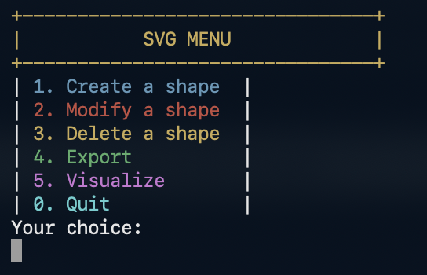

# SVG Project in C

This project lets you create and manage geometric shapes from a terminal menu. You can add circles, rectangles, squares, ellipses, and lines, then edit their dimensions, position, rotation, or fill color, or delete them.

Shapes are kept in memory while the program is running. The export option saves them to an SVG file named `dessin.svg`.

## How to use it

Run the program with:

```sh
./projet_svg
```

The main menu will appear:



Enter the number of the option you want:

- **1. Create a shape**: add a new shape.
  - First, choose a shape type: circle, rectangle, square, ellipse, or line.
  - For shapes other than lines, choose whether to add a fill color.
  - Choose whether to rotate the shape and, if so, enter an angle in degrees.
  - Finally, enter the shape's position and dimensions.

- **2. Modify a shape**: edit a shape that has already been created. The program shows the shapes in memory, then asks which one to modify and which values to update.

- **3. Delete a shape**: remove a shape by entering its number.

- **4. Export**: create the `dessin.svg` file. You can choose to open it after export.

- **5. Visualize**: display the shapes currently stored in memory.

- **0. Quit**: exit the program.

## Example: create and export a drawing

1. Run the program.
2. Choose `1` to create a shape.
3. Select a shape, such as a rectangle or circle.
4. Enter its position and dimensions, and optionally choose a fill color and rotation.
5. Repeat these steps to add more shapes.
6. Choose `4` to export the drawing to `dessin.svg`.
7. Open the generated SVG file to view the result.

Preview of the drawing generated by the project:


## Build and run

Compile the project:

```sh
make build
```

Then start it:

```sh
./projet_svg
```

Alternatively, use `make run` to compile and launch the program in one step.

During development, I worked on creating shapes, managing color memory, and generating the SVG file.
